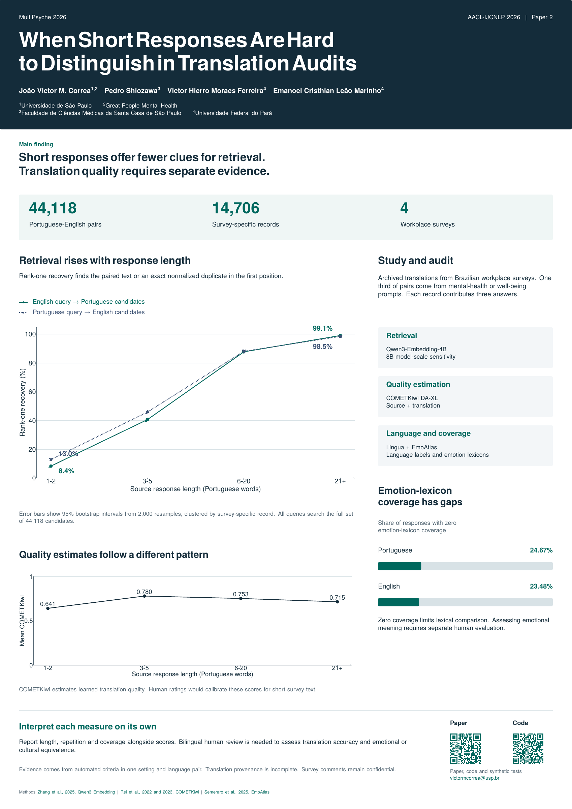

# MultiPsyche 2026 poster

LaTeX source for *When Short Responses Are Hard to Distinguish in Translation
Audits*, paper 2 at MultiPsyche 2026, AACL-IJCNLP 2026.

[Poster PDF](output/pdf/AACL_2026_MultiPsyche_2_poster.pdf) |
[Paper](https://openreview.net/forum?id=Kq2qqKPOUE) |
[Analysis code](https://github.com/vicmcorrea/cross-lingual-translation-audit)

## Build

A fresh clone contains everything needed to compile the poster. Install TeX Live
with pdfLaTeX and latexmk, then run the following command in the repository root.

    make

The result is output/pdf/AACL_2026_MultiPsyche_2_poster.pdf.
To also render output/poster-preview.png, install Poppler and run the following.

    make preview

Open main.tex in a LaTeX editor to edit the poster. The figures are editable
PGFPlots and TikZ source files in figures/.

## Format

- A0 portrait, 841 by 1189 mm, one page.
- The submission instructions allow PDFs up to 20 MB and provide no required template.
- The PDF uses vector plots, selectable text and embedded fonts.
- Paper and code links are clickable and have QR codes.

The [conference instructions](https://docs.google.com/presentation/d/1nAezbzgckj3WKgncHUN0pqZW-jNv7yOg_EiBU8-_ia4/edit)
were checked on 27 October 2026. The workshop's email gives 28 October 2026 as
the poster submission deadline. Its workshop-specific guidance makes the poster
and video optional and encourages submitting at least a poster.
The [upload form](https://aaclijcnlp-2026-presentations.paperform.co/) is separate
from this project.

## Content and figures

The data/ directory contains the aggregate values used by the plots.
data/source_manifest.json records the camera-ready source hashes and metric
definitions. The normal build reads these included tables.

The retrieval chart includes both query directions and the paper's 95% bootstrap
intervals. A correct top-ranked result is the paired target text or an exact
normalized duplicate. Every query searches the full corpus of 44,118 candidates.
COMETKiwi scores and emotion-lexicon coverage are separate measures.

The poster preserves the camera-ready author order and affiliations. It states
the need for bilingual assessment, the incomplete translation provenance and
the study's setting and language-pair scope. Confidential comments are represented
only by aggregate results.

## Refresh the aggregate tables

The optional maintenance script scripts/extract_plot_data.py copies published
values from the camera-ready manuscript. It reads the two retrieval plot tables,
four mean COMETKiwi scores and two zero-coverage percentages.

Run make data with Python 3.14 inside the original manuscript checkout, where
paper.tex, authors_camera_ready.tex, appendix.tex and main_final.pdf are in the
parent directory. This maintenance step is separate from compiling the poster.
